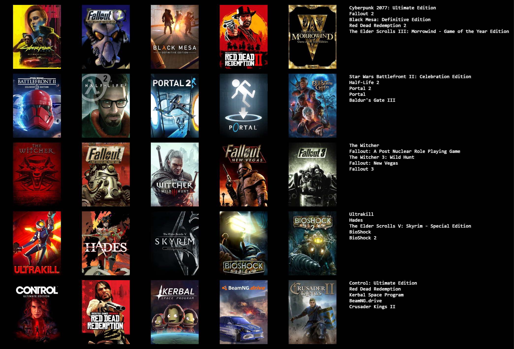

## THE DEFINITIVE and AUTHORITATIVE Source for the Top 25 Video Games as of 2026

Quick random post for my blog to test if my markdown rendering, image embedding, and blog setup work properly. 

### Ordered from top-left to bottom-right:

---

### Why *Cyberpunk 2077* is #1 when I have Red Dead 2 and Fallout 2 on the same list

I genuinely believe that if *Cyberpunk* was given another two years and abandoned the Xbox One and PS4 console generation at launch, it would be *the* open-world RPG. 

I would argue that it would never have been as polished or slice-of-life, realism-heavy as *Red Dead Redemption 2*, nor will it give you the true player agency and choice of *Morrowind* and *BG3*. **But** as a packaged experience and as a standalone game without relying on the history of an IP or the expectation of a sequel like *Fallout 4* and the *BioShock* games did (after *BioShock 1*) I think it's the perfect "video game. It works as a near perfect, neat little package. 

It gives you back whatever you put into it:
* It doesn't demand strict adherence to a rigid gameplay loop like *Red Dead 2*.
* It doesn't require full, homework-level immersion into the lore like *Morrowind* wants with you REALLY getting into the history of the Elder Scrolls games.
* It doesn't bombard you with constant action like *Half-Life* or *Fallout* do a lot of the time.

**But if you want to**, you can dive very, very deep into the lore and read and experience the hidden implications in every decision, either via the game itself or the prior tabletop game lore. It sets up a sequel really well if you look for the bits in each ending, and it can definitely give you non-stop action should you need it. 

To add to the point I said at the start, I feel like Phantom Liberty (which in my opnion is HANDS DOWN the best DLC for a game till date) really showed what CDPR was invisioning for the game when it first came out. The update came with patch 2.1 that brought alot of the promises, technical improvements and gameplay overhauls that felt like they really meshed with the story. If you don't get what I mean, I just BEG that you sit down and spend a weekened playing the game to get what I mean and comparing it to the rest of the game. That section alone already feels like a self contained game on it's own (if it actually realeased as a standalone game, I think it would have won GOTY for Best Narrative), but more importantly it just feels like THAT tiny bit better and more focused? It feels like that entire DLC is what CDPR was really going for in the rest of the game and just fell like SLIGHTLY short. 

It's not perfect, though. It's very clear that CDPR was learning or rather winging, how to make a game like this, a almost GTA-like sandbox paired with a focused almoast linear story...Almoast like a book that lets you live in the world of the story? Like those old "Goosebumps" books in the 2010s. There's a lot that leaves to be desired, sure, but strictly as a **game**, I feel like this is the one I would always recommend to someone if they wanted to sink serious time into it.

---

*Email me if you think otherwise, I crave a good duel >:D*